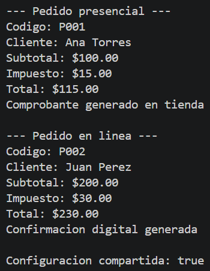

# Universidad Politecnica Salesiana

## Nombre: Sebastian Arenillas

## Sistema de gestion de pedidos

### Patrones de diseno utilizados
## Singleton

Utilice el patron Singleton en la clase ConfiguracionSistema para que exista una sola instancia que controle el porcentaje de impuesto asi todos los pedidos usan la misma configuracion

## Factory Method

Utilice Factory Method para crear los pedidos presenciales y en linea mediante las clases creadoras para poder agregar nuevas modalidades de pedidos sin cambiar el codigo principal del programa

## Salida de consola

